<a href="https://omidrahmanian.github.io/portfolio/"></a>

  
  <a href="https://www.linkedin.com/in/orahmanian/">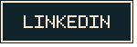</a>
  <a href="mailto:omidr@my.yorku.ca">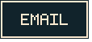</a>

<a href="https://omidrahmanian.github.io/portfolio/"></a>

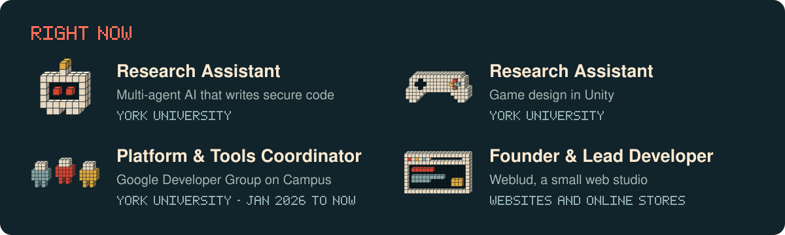

  <a href="https://github.com/OmidRahmanian/threatgraph">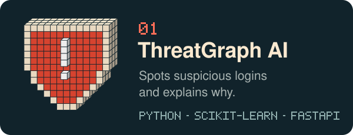</a>
  <a href="https://github.com/OmidRahmanian/Devil-Eyes">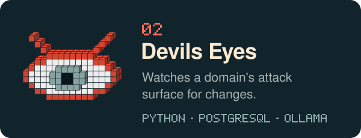</a>
  <a href="https://github.com/OmidRahmanian/ResQnet-AI">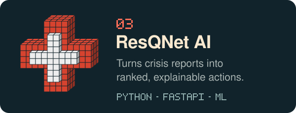</a>
  <a href="https://github.com/OmidRahmanian/AI-Posture-Corrector-and-Analyzer">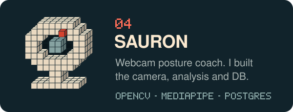</a>
  <a href="https://github.com/OmidRahmanian/Conhack2026">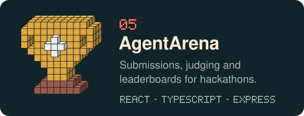</a>
  <a href="https://omidrahmanian.github.io/portfolio/#simpleprep">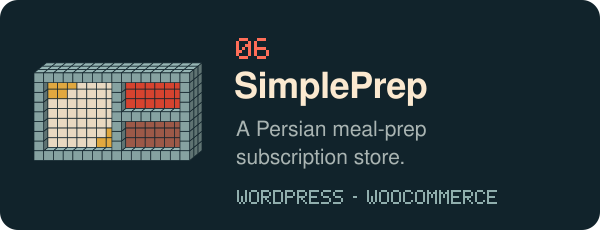</a>

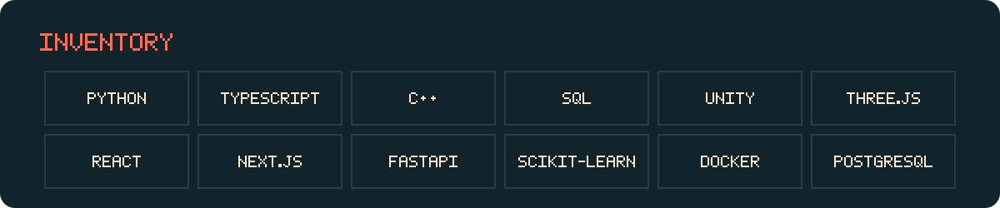

Open to internships, junior roles and research collaborations · <a href="mailto:omidr@my.yorku.ca">omidr@my.yorku.ca</a>

